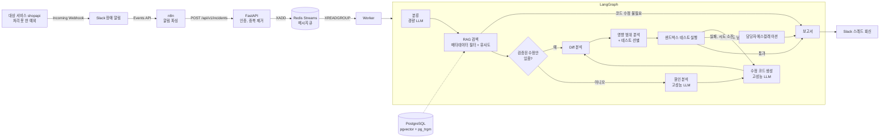

# AI 장애 대응 자동화

Slack 장애 알림을 받아 원인을 분석하고, 수정 코드를 만들고, 관련 회귀 테스트만 골라 검증한 뒤 결과를 Slack 스레드에 회신하는 파이프라인이다. 테스트가 실패하면 실패 로그를 붙여 수정안을 다시 만들고 다시 검증한다. 전 구간에 비용 최적화(캐시, 모델 분리, 범위 축소)를 적용했다.

## 전체 흐름



| 단계 | 구현 위치 | 하는 일 |
| --- | --- | --- |
| 1. Slack 이벤트 | `n8n/incident_workflow.json` | `[서비스] severity: 메시지` 형식의 알림만 통과시키고, 스택트레이스를 분리해서 JSON으로 만든다 |
| 2. n8n | 같은 파일 | FastAPI로 POST. 공유 토큰을 헤더로 보낸다 |
| 3. FastAPI | `app/main.py` | 토큰 검증, 에러 지문으로 중복 알림 제거, 큐 적재 후 바로 202 응답 |
| 4. 메시지 큐 | `app/core/queue.py` | Redis Streams + Consumer Group. 워커를 늘려도 중복 처리가 없고, 죽은 워커의 메시지는 회수된다. 실패 메시지는 DLQ로 보낸다 |
| 5. LangGraph | `app/graph/` | 전체 흐름과 재시도 루프, 예산 초과 시 중단을 관리한다 |
| 6. RAG | `app/rag/` | 증분 임베딩, 메타데이터 필터 우선 검색, 임베딩 캐시, 검색 캐시 |
| 7. LLM 모델 분리 | `app/llm/router.py` | 분류는 경량 모델, 원인 분석과 수정 코드 생성은 고성능 모델 |
| 8. Diff 분석 | `app/analysis/diff_analyzer.py` | 추가, 삭제된 줄과 바뀐 함수, 클래스, 시그니처 변경을 AST로 찾는다 |
| 9. 영향 범위 | `app/analysis/impact.py` | import 그래프를 역방향으로 따라가 영향받는 모듈과 위험도를 계산한다 |
| 10. 테스트 선별, 실행 | `app/analysis/test_selector.py`, `app/testing/runner.py` | 관련 테스트만 골라 원본과 분리된 복사본에서 실행하고, 실패하면 LLM에 다시 보낸다 |

## 1단계 결과

직접 만든 대상 서비스(shopapi)에 버그 13종을 주입하고 실제 LLM(분류 Claude Haiku 5.5, 분석과 수정 Claude Opus 5.5)으로 처리했다. 수정은 LLM이 볼 수 없는 숨은 테스트로 판정했다. 상세와 원본 CSV는 [results/phase1_summary.md](results/phase1_summary.md), 실험 설계는 [docs/plan.md](docs/plan.md) 7장이다.

| 지표 | 최적화 켬(A) | 최적화 끔(B) |
| --- | --- | --- |
| 코드 버그 자동 수정(숨은+전체 테스트 통과) | 9/9 | 8/9 |
| 장애당 평균 LLM 비용 | $0.063 | $0.088 |
| 비코드 장애(외부 결제 지연, 설정 누락) 비용 | 건당 $0.0003 | 건당 $0.044 |
| 같은 장애 재발 시 LLM 호출 | 0회(검증된 수정안 재사용) | 3회 |
| 같은 알림 10건 | 1건만 처리 | 1건만 처리 |
| 처리 시간 중앙값 | 27초 | 30초 |

- 행 기준 A가 B보다 28% 싸다. 차이의 출처는 코드 버그의 분류 모델(Haiku), 비코드 장애의 조기 종료, 재발 시 수정안 재사용이다(시나리오 유형별로 나눈 합이 전체 차이와 맞음).
- 조건마다 1회 실행이다(비용 절약, [decisions/0010](docs/decisions/0010-single-run-ab.md)). 작은 차이는 판단을 보류한다.
- 시그니처가 어긋난 버그(S08)는 조건마다 3회 돌려 6회 중 5회가 공개 테스트를 모두 통과한 잘못된 수정이었다. 숨은 테스트만 이를 잡았다. "테스트 통과"를 그대로 믿으면 안 되는 장애 유형이 있다.
- Slack 실연동: shopapi 장애가 `#alert`에 올라오면 25~31초 안에 같은 스레드에 검증된 수정안이 회신된다(실제 LLM 3건, [results/day4_slack.md](results/day4_slack.md)).

## 비용 최적화 포인트

### RAG

- 증분 임베딩: `documents` 테이블의 `(doc_id, chunk_hash)` 행이 매니페스트다. 다시 수집할 때 청크 해시와 메타데이터가 같으면 건너뛰고, 바뀐 문서는 새로 생긴 청크만 임베딩하고 사라진 청크만 지운다. 메타데이터만 바뀌면 임베딩 없이 칼럼만 고친다. 임베딩 모델이 바뀐 행은 다시 임베딩한다.
- 문단 경계 청킹: 고정 길이로 자르면 한 줄 수정에도 뒤쪽 청크 경계가 전부 밀려서 모든 청크를 다시 임베딩하게 된다. 제목과 빈 줄 기준으로 잘라서 수정된 문단의 청크만 바뀌게 했다.
- 포인트 ID = uuid5(doc_id:chunk_hash): 내용이 같은 청크는 위치가 바뀌어도 같은 ID라서 다시 넣을 필요가 없다.
- 임베딩 캐시: 텍스트 해시를 키로 벡터를 Redis에 저장한다. 여러 문서에 반복되는 문단, 반복되는 검색 질의는 다시 임베딩하지 않는다.
- 메타데이터 필터 우선 하이브리드 검색: 서비스(+공통 문서), 카테고리, 날짜(최근 N일)로 후보를 먼저 좁히고, 그 안에서 pgvector 유사도 순위와 pg_trgm 키워드 순위를 RRF로 합친다. 에러 코드나 환경변수 이름처럼 본문에 그대로 있는 식별자를 벡터만으로는 놓치는 경우를 키워드 순위가 보완한다([비교 결과](results/phase2_retrieval.md)). 필터 결과가 0건이면 서비스 조건만 남기고 한 번 더 찾는다.
- 검색 결과 캐시: 질의에서 주문번호, 시간 같은 가변 값을 지운 뒤 캐시 키를 만든다. 문서가 바뀌면 컬렉션 버전을 올려 캐시를 자동 무효화한다.
- 기본 임베딩은 로컬 fastembed(다국어 MiniLM)라 API 비용이 들지 않는다.

### LLM

- 모델 분리: `classify`, `summarize`는 경량 모델, `root_cause`, `generate_fix`는 고성능 모델로 보낸다(`TASK_TIER`).
- 분류 캐시: 에러 지문(숫자, UUID, 시간을 지운 메시지 + 스택 프레임)을 키로 분류 결과를 캐시한다. 같은 종류의 에러는 분류 LLM을 다시 부르지 않는다.
- 조기 종료: 인프라, 설정 장애처럼 코드 수정이 필요 없으면 고성능 모델을 부르지 않고 런북 안내로 끝낸다.
- 검증된 수정안 재사용: 테스트를 통과한 수정안을 지문 기준으로 7일간 저장한다. 배포 전에 같은 에러가 재발하면 LLM 호출 없이 테스트만 다시 돌린다.
- 입력 축소: 스택트레이스 주변 코드와 의심 파일만 넣고, 문서 청크와 실패 로그는 길이 상한을 둔다. 실패 로그는 pytest의 FAILURES 섹션만 남긴다.
- 예산 상한: 장애 1건당 LLM 비용이 `INCIDENT_BUDGET_USD`를 넘으면 그래프를 멈추고 담당자에게 넘긴다. 일별 모델별 비용도 `cost:daily:YYYYMMDD`에 쌓인다.
- 중복 알림 제거: 알림이 폭주해도 같은 지문은 `DEDUPE_TTL_SEC` 동안 파이프라인을 한 번만 돈다.

### 회귀 테스트

- 전체 테스트 대신 영향 범위 안에 들어온 테스트, 패치가 직접 고친 테스트, 이름 규칙(`pricing.py` -> `test_pricing.py`)에 맞는 테스트만 실행한다.
- 직접 import하는 모듈은 바뀐 심볼 이름을 실제로 참조하는 경우만 포함해서 범위를 줄인다. 2단계 이상은 동작 변경이 전파될 수 있으므로 모두 포함한다.
- 코드 외 파일(설정, requirements), conftest 변경이 있거나 선택된 테스트가 0개면 안전하게 전체 테스트로 대체한다.
- 실패하면 실패 로그를 붙여 수정안을 다시 생성하고 다시 검증한다. `MAX_FIX_ATTEMPTS`를 넘으면 에스컬레이션한다. 패치 형식이 틀리면 테스트까지 가지 않고 바로 재생성한다.

## 실행

### 1. API 키 없이 전체 흐름 확인

Redis, LLM은 메모리 대역으로 바꿔서 한 프로세스에서 돌린다. 장애 기록은 PostgreSQL에만 있으므로 PostgreSQL 컨테이너 하나는 띄운다(데모와 테스트는 `aiops_test` 데이터베이스를 만들어 쓴다). 첫 수정안은 일부러 회귀를 일으키도록(정수 나눗셈) 만들어 두어서 재시도 루프를 볼 수 있다.

```bash
pip install -r requirements.txt
docker compose up -d postgres
python -m scripts.demo_offline
python -m pytest
```

데모에서 확인할 수 있는 것은 다음과 같다.

- 같은 문서를 다시 수집하면 임베딩 0회
- 주문번호만 다른 중복 알림은 같은 incident로 묶임
- 첫 수정안이 `2 failed`로 실패하고, 실패 로그를 받은 두 번째 수정안이 통과
- `shop/pricing.py` 변경 시 `test_cart.py`, `test_pricing.py`만 실행되고 `test_inventory.py`는 제외
- 같은 에러 재발 시 LLM 호출 0회(분류 캐시 + 검증된 수정안 재사용)
- 결제 타임아웃 같은 인프라 장애는 경량 모델 1회만 호출

### 2. docker compose로 실제 구성 실행

```bash
cp .env.example .env      # ANTHROPIC_API_KEY, SLACK_BOT_TOKEN, AUTOMATION_TOKEN 채우기
docker compose up -d --build
docker compose exec api python -m scripts.ingest_knowledge knowledge
```

n8n(http://localhost:5678)에서 `n8n/incident_workflow.json`을 Import한 뒤 Slack Trigger 노드에 Slack 자격 증명과 장애 채널을 지정하고 활성화한다. 노드 버전은 n8n 버전에 따라 다를 수 있으므로 Import 후 각 노드 설정을 한 번 확인한다.

Slack 알림은 다음 형식을 기준으로 파싱한다.

````
[checkout] critical: 500 on /orders/summary
```
Traceback (most recent call last):
  File "/app/shop/pricing.py", line 13, in unit_price
ZeroDivisionError: float division by zero
```
````

API를 직접 호출해서 확인할 수도 있다.

```bash
curl -X POST localhost:8000/api/v1/incidents \
  -H "X-Automation-Token: $AUTOMATION_TOKEN" -H "Content-Type: application/json" \
  -d '{"channel":"C123","service":"checkout","message":"ZeroDivisionError","stacktrace":"..."}'
curl localhost:8000/api/v1/incidents/<incident_id> -H "X-Automation-Token: $AUTOMATION_TOKEN"
```

### 3. 장애 시나리오 실행(검증 1단계)

워커는 `targets/shopapi`(주문, 쿠폰, 재고, 결제, 목록 조회를 가진 작은 FastAPI 서비스)를 대상 저장소로 쓴다. 시나리오는 `scenarios/<ID>.yaml`(기대 결과, 재현 요청), `<ID>.patch`(정상 코드에 넣는 버그), `hidden_tests/`(LLM이 보지 못하는 판정용 테스트)로 이뤄진다. 계획은 [docs/plan.md](docs/plan.md)에 있다.

```bash
docker compose up -d --build
docker compose exec worker python -m pytest /repo -q -p no:cacheprovider   # shopapi 테스트가 워커 안에서 도는지 확인
docker compose exec api python -m scripts.ingest_knowledge knowledge
set -a; . ./.env; set +a                                                    # AUTOMATION_TOKEN을 셸에 불러온다
python -m scripts.run_experiment S01 S10 --condition A --repeat 3 --out results/phase1_A.csv
```

`run_experiment`는 먼저 서버의 최적화 설정(`/api/v1/config`)이 `--condition`(A는 모두 켬, B는 `.env`의 `OPT_*`를 모두 끔)과 같은지 확인한다. 실행마다 캐시를 비우고, 버그를 주입한 shopapi로 장애를 재현해 `/api/v1/incidents`로 접수한 뒤 완료를 기다린다. 끝나면 AI 패치를 버그가 든 복사본에 적용해 숨은 테스트와 전체 테스트를 돌리고, 결과를 CSV에 한 줄 붙인다. 선별 테스트는 통과했지만 숨은 테스트가 실패하면 `false_pass`가 참이다. 재발(S12)과 중복(S13)도 같은 명령으로 실행한다.

Slack 실연동은 Slack 앱(봇 토큰, Incoming Webhook, Signing Secret, Event Subscriptions)과 ngrok이 필요하다. 설정 절차는 [docs/features/F08-slack.md](docs/features/F08-slack.md)에 있고, `python -m scripts.setup_n8n`이 n8n 설정을, `python -m scripts.slack_e2e S01`이 알림부터 스레드 회신까지 확인을 한다.

### 4. 실제 서비스 저장소에 붙이기

- `docker-compose.yml`의 `./targets/shopapi:/repo:ro`를 대상 서비스 저장소로 바꾼다. 운영에서는 워커가 배포된 커밋을 clone해서 쓰는 방식이 맞다.
- `knowledge/` 아래에 런북, 포스트모템을 front matter(`service`, `category`, `doc_type`, `updated_at`)와 함께 넣고 `scripts.ingest_knowledge`를 주기적으로(문서 저장소 push 시 CI 등) 실행한다. 바뀐 청크만 임베딩되므로 자주 돌려도 비용이 거의 들지 않는다.

## 폴더 구조

```
AI_automation/
├── app/
│   ├── main.py              # FastAPI (접수, 상태 조회, 지식 문서 수집)
│   ├── worker.py            # 큐 소비 워커
│   ├── container.py         # 의존성 조립
│   ├── config.py            # 환경변수 설정
│   ├── core/                # 에러 지문, Redis Streams 큐, 상태 저장소
│   ├── rag/                 # 청킹, 임베딩 캐시, 증분 수집, 필터 검색
│   ├── llm/                 # 모델 라우터, 비용 추적, 프롬프트, 출력 스키마, 가짜 LLM
│   ├── analysis/            # 코드 컨텍스트, Diff 분석, 영향 범위, 테스트 선별
│   ├── testing/runner.py    # 샌드박스 패치 적용 + pytest 실행
│   ├── graph/               # LangGraph 상태, 노드, 워크플로
│   └── notify/slack.py      # 결과 회신
├── n8n/incident_workflow.json
├── knowledge/               # RAG 원천 문서 예시
├── sample_repo/             # 오프라인 데모용 대상 저장소(버그 포함)
├── targets/shopapi/         # 검증용 대상 서비스와 테스트
├── scenarios/               # 장애 시나리오(정의, 버그 패치, 숨은 테스트)
├── scripts/                 # 오프라인 데모, 지식 문서 수집, 버그 주입, 시나리오 실행
├── tests/                   # 파이프라인 테스트
├── docker-compose.yml
└── Dockerfile
```

## 주의할 점

- 수정안은 자동으로 머지하지 않는다. 검증된 패치를 `artifacts/<incident_id>.patch`로 저장하고 Slack에 올려 사람이 승인하도록 했다. PR 자동 생성은 이 지점에 붙이면 된다.
- 테스트 실행은 임시 디렉터리 복사본에서 하지만, 이것만으로는 LLM이 만든 코드를 격리했다고 볼 수 없다. 운영에서는 테스트를 네트워크가 차단된 별도 컨테이너(`docker run --network none`)나 Job에서 실행해야 한다.
- Diff, 영향도 분석은 Python 저장소 기준이다. 다른 언어는 `ImportGraph`를 해당 언어의 의존성 분석 도구로 바꿔야 한다.
- `.env.example`의 모델 단가는 예시 값이다. 실제 요금표에 맞춰 `MODEL_PRICES`를 고쳐야 비용 추적과 예산 상한이 맞게 동작한다.
